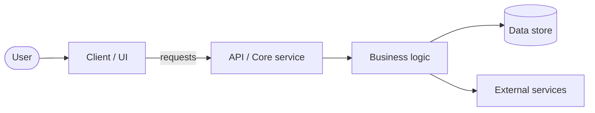
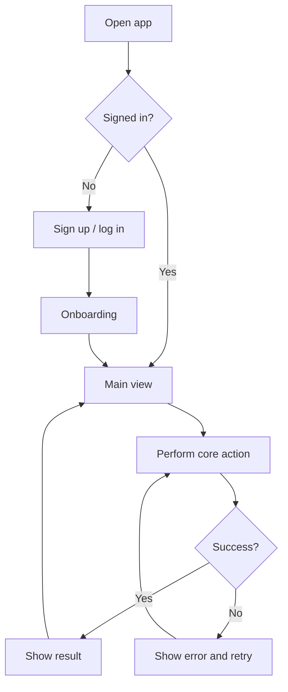
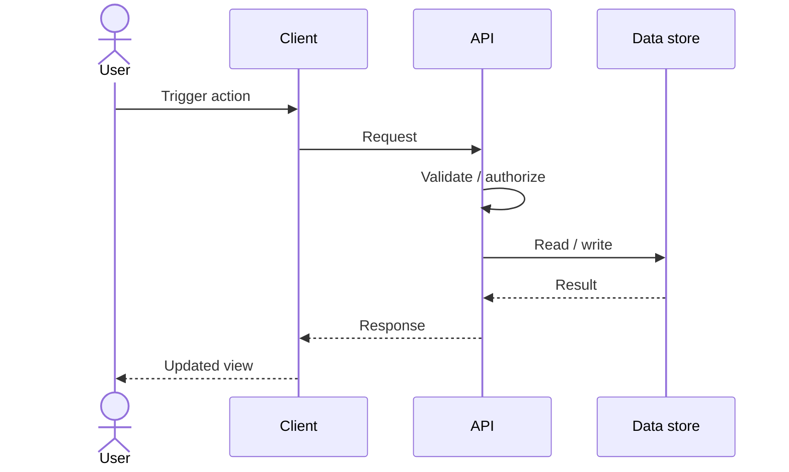

# Architecture

Draft: the product is not yet defined, so the diagrams below are a generic
placeholder structure. Replace component names as decisions are made, and record
significant revisions in [changes.md](changes.md).

Diagrams use [Mermaid](https://mermaid.js.org/), which GitHub and VS Code render.

## System architecture

| Component | Responsibility | Status |
| --------- | -------------- | ------ |
| Client / UI | User-facing interface | TBD |
| API / Core service | Entry point, validation, auth | TBD |
| Business logic | Core domain behavior | TBD |
| Data store | Persistence | TBD |
| External services | Third-party integrations | TBD |

## User flow

## Request sequence (core action)

## Decisions and constraints

- _TODO: stack, hosting, auth approach, data model_

## Open questions

- _TODO_
