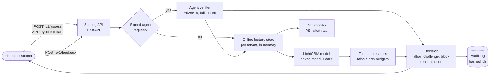
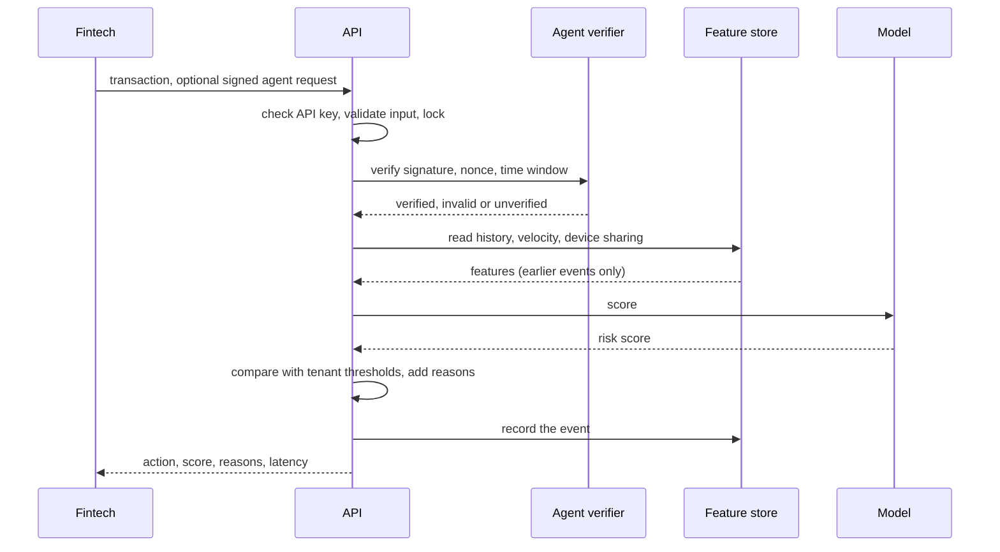

# Architecture

This describes what exists today. It is a prototype: state lives in memory and the API runs as one process.
Diagrams use Mermaid, which GitHub and VS Code render.

## System as built

## One request

## Fast path and slow path

| | Fast path (per transaction) | Slow path (offline) |
| --- | --- | --- |
| What | Verify, read features, score, decide | Build features, train, calibrate, evaluate |
| Where | `agentshield/serving`, `features_online`, `agent_trust` | `agentshield/txn`, `scripts/train_serving.py` |
| Speed | p50 0.8 ms over local HTTP | Minutes |
| Output | A decision with reasons | A versioned model and model card |

## Decisions we made, and why

- **Time split with a label delay gap.** Real fraud labels arrive late, and random splits leak the future.
- **Every feature looks backwards only.** Each one has a test that changes later rows and checks nothing moves.
- **The real-time store must match the batch code.** A parity test compares them row by row.
- **State is per tenant.** A security review found that one shared store let customers affect each other.
- **Server time, not client time.** A forged timestamp could wipe a customer's history.
- **Anything unknown means challenge or block.** Scoring errors, a missing verifier or a NaN score never allow.
- **Scores are compared strictly above the threshold,** the same rule used when the thresholds were calibrated.

## What is prototype and what production needs

| Today | Production |
| --- | --- |
| In-memory feature and result state (nonces can already use Redis) | Redis for features and results too, shared across workers |
| One worker process | Several workers behind a proxy |
| Records written straight from the request | Kafka for events, a data lake for training |
| Model trained on public US card data | Retrained on each customer's own labels in shadow mode |
| No rate limits | Limits and body size caps at a proxy |
| Agent keys from a registry file or a fetched key directory with signature checks, tested against a live public directory | The same, with monitoring and a per-tenant allowlist of directories |
